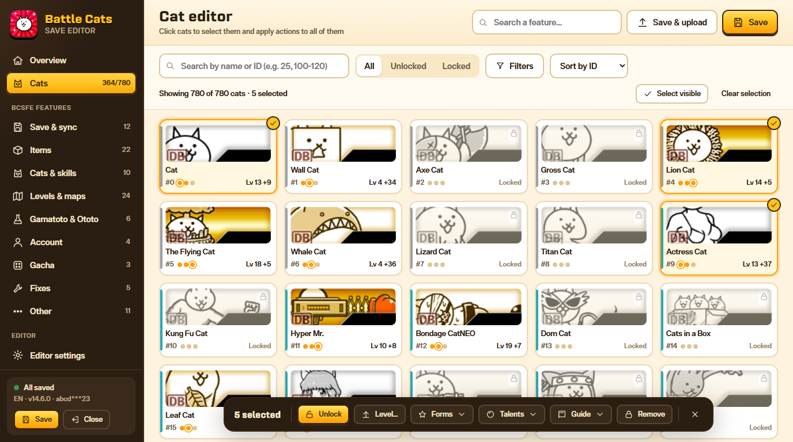
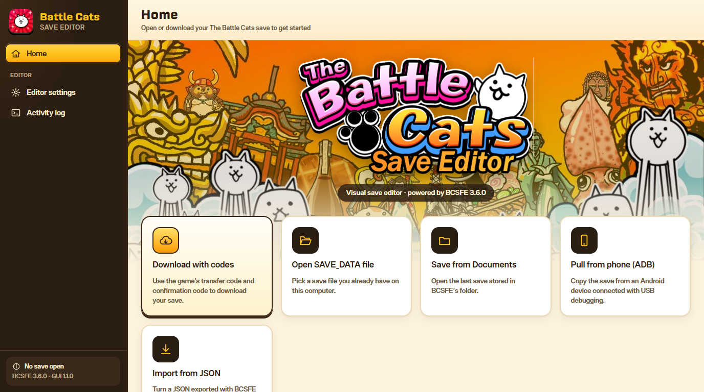
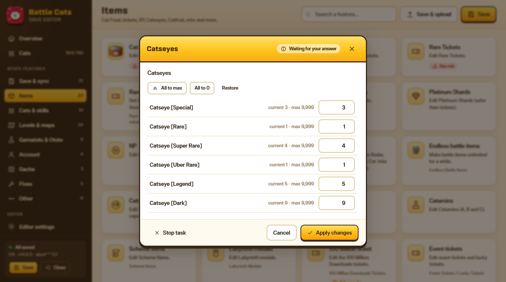

# Battle Cats Save Editor (interfaz gráfica de BCSFE)

Interfaz visual, con menús y botones, para
[BCSFE-Python](https://codeberg.org/fieryhenry/BCSFE-Python) 3.6, el editor de
saves de The Battle Cats de fieryhenry. Todas las funciones de BCSFE están
disponibles y usan su propio código, así que funcionan igual que en la consola,
pero cada pregunta aparece como un diálogo (botones, casillas, campos numéricos,
selector de archivos de Windows…).

*Read in English: [README.md](README.md)*

| Pantalla de inicio | Preguntas de BCSFE como diálogos |
| --- | --- |
|  |  |

## Qué puedes hacer

- **Abrir tu partida**: descargarla con el código de transferencia y el de
  confirmación, abrir un archivo `SAVE_DATA`, cargar el save de Documentos,
  extraerlo del móvil por ADB o importarlo desde un JSON.
- **Resumen**: comida de gato, XP, tickets, NP, liderazgo, Catseyes y objetos de
  batalla de un vistazo; pulsa cualquiera para cambiarlo.
- **Editor visual de gatos**: todos los gatos con su imagen, buscador por nombre
  o ID (`25`, `100-120`), filtros por rareza, forma, objetivo (rojo, flotante,
  metal…), habilidad e inmunidad. Selecciona varios (clic, Mayús+clic, Ctrl+A) y
  desbloquéalos, cambia su nivel, dales forma verdadera o cuarta forma, talentos
  al máximo, guía de gatos… Doble clic en un gato para ver su ficha.
- **Todas las funciones de BCSFE** en el menú lateral, con buscador de funciones.
- **Guardar** (Ctrl+S), **Guardar como…** y **Guardar y subir**, que sube el save
  a los servidores del juego y muestra los códigos nuevos para recuperarlo en el
  móvil (Transferir datos → Reanudar partida).
- **Inglés o español**: la interfaz y los mensajes de BCSFE se cambian en
  *Ajustes del editor → Idioma* (la traducción al español de BCSFE está en
  `locales/es`).

## Requisitos

- Windows 10/11 con Microsoft Edge (viene instalado). Si no hay Edge ni Chrome,
  se abre en el navegador predeterminado.
- Python 3.9 o superior.
- BCSFE 3.6.0 y sus dependencias: `py -m pip install -r requirements.txt`
  (otras versiones de BCSFE podrían no funcionar). Si hay una carpeta
  `BCSFE-Python-main` junto a esta, se usa esa copia.

## Cómo abrirlo

Doble clic en **`Start Editor.vbs`**. Se abre en su propia ventana y se cierra
solo al cerrarla. Si algo falla al arrancar, abre
**`Start Editor (console).bat`**, que deja una consola con el error.

## A tener en cuenta

- Cada save que abres se copia como copia de seguridad en
  `Documentos\bcsfe\saves\backups`.
- Editar comida de gato o tickets raros / de platino / de leyenda puede provocar
  un baneo; esas opciones están marcadas con **Riesgo de baneo**.
- "Cancelar" equivale a salir de esa pregunta en la consola. Si un menú vuelve a
  aparecer en bucle, el editor elige su opción de salida; también puedes pulsar
  **Detener tarea**.
- La configuración, los datos y los saves de BCSFE son los mismos que usa la
  versión de consola. Los ajustes de esta interfaz se guardan en
  `%LOCALAPPDATA%\BCSFE_GUI\settings.json`.

## Créditos y licencia

- BCSFE-Python de fieryhenry (GPL-3.0). Este proyecto usa la misma licencia
  (ver [LICENSE](LICENSE)).
- Las imágenes de gatos, objetos y habilidades, las fuentes y el logo vienen del
  proyecto *Battle Cats Save Editor GUI* de Illusion137.
- The Battle Cats y su arte pertenecen a PONOS Corporation. Es una herramienta
  no oficial, sin relación con PONOS. Úsala bajo tu responsabilidad.
